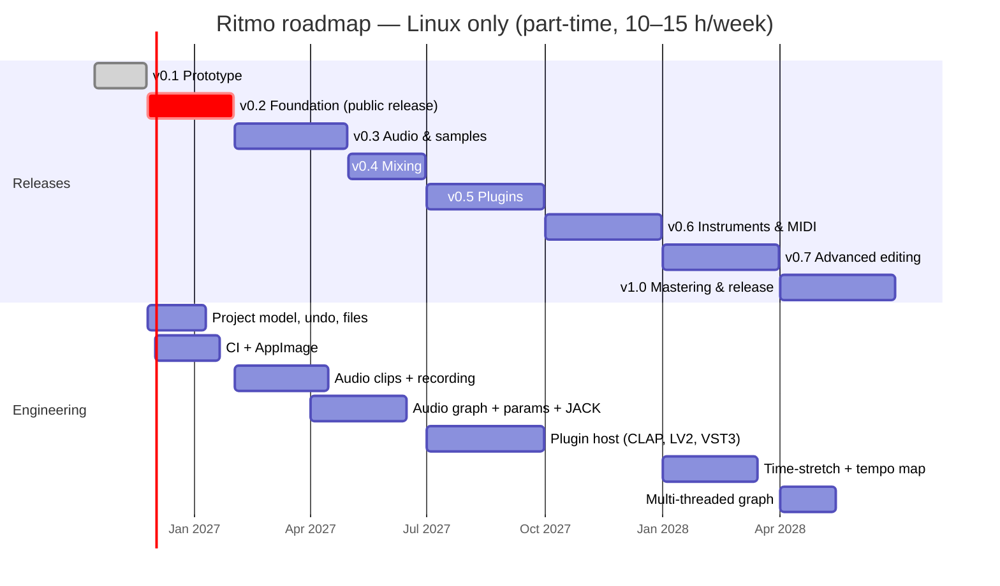

# Ritmo Roadmap

**Goal:** a free, open-source, general-purpose DAW for **Linux**, written in Rust, that covers the whole production process (writing, sound design, recording, editing, arranging, mixing, mastering and delivery) well enough to finish professional-quality songs in any genre, from hip-hop and EDM to pop, rock, film scoring and podcasts.

**Value proposition:** *A complete DAW for Linux that runs on just a laptop, with sample chopping built in.* Ritmo is a general-purpose DAW first: patterns and a playlist, a piano roll, a mixer, recording and plugins, for any genre. Its signature feature is the chop sampler: drop in any audio, chop it onto 16 pads in seconds (at the hits, in even slices or by tapping), flip it with pitch and reverse, and sequence the chops like any other instrument. Free and open source.

**Platform:** Linux only for now. Windows and macOS are not planned before 1.0; the engine stays portable so a port stays possible later.

**Starting point (v0.1, November 2026):** a 4-bar pattern sequencer with synth drums, an FM electric piano, a sine bass, a piano roll, a playlist, a 4-bus mixer with meters and one master effect chain. It has no save/load, no audio tracks, no samples and no plugins.

**First public release:** **v0.2 "early access", 31 January 2027.**

**Timeline assumption:** one developer working part-time (about 10–15 hours a week) with AI help. Every release is something you can produce music with. Dates move if the hours change; the order matters more than the dates.

---

## 1. Product

### Principles

1. **Covers every stage of production.** No stage should force you to switch to another DAW: writing, recording, editing, mixing, mastering, export.
2. **Pattern workflow and linear workflow are both first-class.** Beatmakers build from patterns; bands and songwriters record linear takes. The playlist holds both.
3. **A first-class Linux citizen.** PipeWire and JACK, LV2 and CLAP plugins, Wayland and X11, packaged where Linux users install software (Flatpak, AppImage, AUR).
4. **Industry standards.** CLAP, LV2 and VST3 plugins, MIDI and MIDI 2.0, WAV/FLAC/MP3 export, stems, LUFS loudness.
5. **Audio quality comes first.** 32-bit float throughout (64-bit mix bus option), sample rates up to 192 kHz, sample-accurate automation, plugin delay compensation, no dropouts.
6. **Runs on a laptop.** Light on CPU and memory, usable without a MIDI keyboard, scales up when you add hardware.
7. **Sampling is a first-class workflow.** Chopping, flipping and resampling audio are as quick as programming drums; chops are ordinary notes, so every editor works with them.

### Who it is for

| User | Typical work | Ritmo must let them |
|---|---|---|
| **Beatmaker** (hip-hop, trap, lo-fi, R&B) | Patterns, samples, chopping, 808s | Build a full beat from samples and patterns, chop and pitch loops, mix and export stems |
| **Electronic producer** (house, techno, EDM, DnB) | Synths, automation, sidechain, arrangement | Design sounds, automate everything, sidechain, build arrangements with drops, master loud |
| **Songwriter / band** (pop, rock, indie, acoustic) | Recording vocals and instruments, takes | Record many tracks at once, comp the best takes, edit timing and pitch, mix with buses |
| **Mixing / mastering engineer** | Imported stems, plugins | Import stems, route buses and sends, use pro plugins, meter loudness, deliver masters |
| **Composer / content creator** (film, games, podcasts) | Sample libraries, video, voice | Use big sample libraries, sync to video, change tempo and time signature, edit dialogue |

### How we know it works (release goals)

- **v0.2 (Jan 2027):** a new user installs the AppImage, makes a full song from patterns, saves it, reopens it, exports it, with no crash.
- **v0.4:** record and mix a 4-piece band demo (16 audio tracks) without dropouts on a mid-range Linux laptop with PipeWire.
- **v0.5:** open a session with 20 third-party plugins (LV2, CLAP, VST3), automate them, save, reopen, and get the same sound.
- **v1.0:** finish a release-ready track in each of four styles (beat, electronic, band, score), with demo projects included.

### Feature areas

Each release adds to these areas. The **Release plan** below says when.

| Area | Scope at v1.0 |
|---|---|
| **Project & session** | Save/open, autosave and crash recovery, undo history, templates, collect-and-save (copies samples into the project), project notes |
| **Timeline & arrangement** | Pattern, MIDI, audio and automation clips on one playlist; tracks and folders; markers and sections; loop and punch ranges; tempo and time-signature changes and automation; insert/delete time |
| **MIDI & composition** | Full piano roll (length, velocity, CC, pitch bend, slide notes), step sequencer, chord and scale tools, arpeggiator, quantize and groove templates, MIDI recording with overdub and loop record, MIDI controller mapping, MPE |
| **Instruments** | Sampler and multi-sampler (SFZ), slicer, drum machine, subtractive/wavetable synth, FM synth, electric piano, 808-style bass, SoundFont (SF2) player |
| **Audio recording & editing** | Multi-input recording, low-latency monitoring, punch-in, loop takes and comping, trim/fade/crossfade, time-stretch and warp markers, pitch shift, pitch correction, transient detection |
| **Mixing** | Unlimited channels, inserts, pre/post sends, buses, groups/VCA, sidechain routing, pan laws, phase invert, mono check, mute/solo/record arm, channel strip presets |
| **Built-in effects** | Parametric EQ, compressor (with sidechain), multiband compressor, limiter, gate/expander, de-esser, saturation, delay, reverb (algorithmic and convolution), chorus/flanger/phaser, filter, transient shaper, stereo tools, pitch/formant, vocoder, bitcrusher, tape/vinyl |
| **Automation** | Automation lanes on tracks and clips, every parameter automatable (built-in and plugin), curves, latch/touch/write recording modes |
| **Plugins** | LV2, CLAP and VST3 hosting (instruments, effects, MIDI effects), crash-safe scanning, plugin GUIs, presets, delay compensation, sidechain inputs |
| **Metering & mastering** | Peak/RMS/LUFS meters, true-peak, spectrum analyzer, correlation meter, reference-track A/B, master chain presets |
| **Export & delivery** | WAV/FLAC/MP3/OGG, sample rate and bit depth choice, dither, stem and multitrack export, loudness-normalized export |
| **Hardware & I/O** | PipeWire (native or through its JACK/ALSA layers), JACK, ALSA; multi-channel interfaces; MIDI controllers with presets; MIDI clock and JACK transport sync |
| **Workflow & UI** | Docked workspace, browser for samples/presets/plugins, key commands, zoom, HiDPI on Wayland and X11, themes, video track for scoring |

### Release plan

| Version | Target | Theme | You can now… |
|---|---|---|---|
| v0.1 | Nov 2026 ✅ | Prototype | Make a 4-bar loop |
| **v0.2** | **31 Jan 2027** | **Foundation — first public release** | Arrange full songs with many patterns, save them, undo anything, install from an AppImage |
| v0.3 | Apr 2027 | **Audio & samples** | Record audio, import and edit samples and loops, use a sampler |
| v0.4 | Jun 2027 | **Mixing** | Mix properly: inserts, sends, buses, sidechain, automation, pro built-in effects |
| v0.5 | Sep 2027 | **Plugins** | Use LV2, CLAP and VST3 instruments and effects |
| v0.6 | Dec 2027 | **Instruments & MIDI** | Design sounds with built-in synths, play MIDI controllers, record MIDI |
| v0.7 | Mar 2028 | **Advanced editing** | Comp takes, warp audio, correct pitch, change tempo over time |
| v1.0 | Jun 2028 | **Mastering & release** | Master, meter loudness, deliver stems; install from Flathub; stable file format |

Supporting one platform instead of three saves about two months compared with a cross-platform plan.

#### v0.2 Foundation — first public release (Dec 2026 – 31 Jan 2027)
- Project model with save/open and autosave.
- Undo/redo for every edit.
- Unlimited patterns; any pattern placed anywhere on the playlist; move, resize, copy and delete clips; songs up to 999 bars; loop range.
- Piano roll: note length, velocity, selection, copy/paste, snap.
- Metronome; typing-keyboard octave shift.
- Audio settings: output device, sample rate, buffer size (PipeWire/ALSA through `cpal`).
- **Chop sampler:** load WAV/FLAC/MP3/OGG, chop at the hits, into even slices or by tapping; 16 pads played from the keyboard; per-pad pitch, reverse and level; chops sequenced as notes in the Channel Rack, Piano Roll and Playlist.
- GitHub Actions CI (build, test, clippy).
- **Release package:** AppImage, AUR package (`ritmo-bin`), 2–3 demo projects, a short demo video, release notes that say clearly it is early access.

Not in v0.2 (moved to v0.3 or later): markers, tempo and time-signature changes, recording MIDI from the keyboard, crash recovery dialog.

#### v0.3 Audio & samples (Feb – Apr 2027)
- Audio tracks and audio clips on the playlist.
- Record from one or more inputs with monitoring; punch-in and punch-out.
- Import WAV/FLAC/MP3/OGG/AIFF; browser with folders, search and preview.
- Clip editing: trim, split, fade, crossfade, gain, reverse, normalize.
- Sampler extensions: key-mapped (multi-octave) playback, time-stretched chops, resampling a flip into a new sample, CC0 starter sample packs. (The chop sampler itself moved up to v0.2.)
- Simple time-stretch to fit loops to the project tempo.
- Markers, time signature, tempo changes; record what you play into the piano roll.
- Export WAV/FLAC/MP3 with a range choice. Flatpak package.

#### v0.4 Mixing (May – Jun 2027)
- Audio graph engine with unlimited mixer channels.
- 10 insert slots per channel; pre- and post-fader sends; buses and groups.
- Sidechain routing from any channel to any effect.
- Automation lanes for every built-in parameter, with curves and recording modes.
- Built-in pro effects: parametric EQ, compressor, limiter, gate, de-esser, saturation, delay, algorithmic reverb, chorus/flanger/phaser, filter, stereo tools. The current lo-fi chain becomes separate tape, vinyl and bitcrusher effects.
- Meters: peak, RMS, LUFS; spectrum analyzer on any channel.
- Mute/solo/arm, phase invert, mono check, channel colors and presets.
- JACK support (native JACK backend for JACK users and PipeWire's JACK layer).

#### v0.5 Plugins (Jul – Sep 2027)
- **CLAP** hosting first, then **LV2** (the native Linux standard, with many free plugins: LSP, Calf, x42, Dragonfly), then **VST3** (check the SDK license before shipping).
- Crash-safe plugin scanning in a separate process, with a list of failed plugins.
- Plugin windows (most Linux plugin GUIs need X11, so Ritmo runs them through XWayland on Wayland), presets, state saved in the project, parameter automation.
- Plugin delay compensation across the whole graph.
- Sidechain inputs and multi-output instruments.
- Ritmo's own instruments and effects also built as CLAP/LV2 plugins.
- Not planned: VST2 (no longer licensed by Steinberg), AU (macOS only).

#### v0.6 Instruments & MIDI (Oct – Dec 2027)
- Built-in synth: wavetable and virtual-analog oscillators, unison, filters, envelopes, LFOs, mod matrix, effects, presets.
- FM synth, electric piano, 808-style bass, multi-sampler with SFZ, SoundFont (SF2) player.
- MIDI input from controllers (ALSA sequencer and JACK MIDI), MIDI learn and mapping presets, MIDI clock and JACK transport.
- MIDI recording: overdub, loop record, step input.
- Piano roll: CC and pitch-bend lanes, slide notes, chord stamps, strum, arpeggiator, groove templates. MPE support.

#### v0.7 Advanced editing (Jan – Mar 2028)
- Loop recording with take lanes and comping.
- Warp markers, high-quality time-stretch and pitch-shift, transient detection.
- Pitch correction (automatic and note-based editing).
- Tempo and time-signature automation, with audio following tempo.
- Bounce and freeze tracks; render in place.
- Convolution reverb, multiband compressor, transient shaper, vocoder, pitch/formant effects.

#### v1.0 Mastering & release (Apr – Jun 2028)
- Mastering tools: true-peak limiter, loudness targets, reference-track A/B, master presets.
- Export: stems, multitrack, dither, sample rate and bit depth choice, loudness-normalized export.
- Docked workspace, saved layouts, key-command editor, HiDPI, themes.
- Video track for scoring (moves after 1.0 if it delays the release).
- Templates and demo projects in four styles (beat, electronic, band, score).
- Packages: Flathub, AppImage, AUR; distro packaging help for Debian/Ubuntu and Fedora.
- Stable, versioned project-file format; user manual and website.

#### After 1.0 (ideas, not committed)
Windows and macOS ports, an MCP server so AI agents can build and edit projects (for example "chop this record at the hits and make a 90 BPM beat"), clip launcher for live performance, modular instrument, audio-to-MIDI, stem separation, surround/Atmos, network collaboration, scripting API, AI assistants, tablet/touch UI.

---

## 2. Technical roadmap

### Target architecture

```
UI thread (egui)                 Engine (real-time)                  Workers
──────────────────               ─────────────────────               ───────────────────
Project model + commands  ──►    Transport & sequencer               Sample decode / load
(undo, autosave, files)          Audio graph (sorted nodes)          Disk read / record write
                          snap-  ├─ instruments & audio clips         Plugin scanner (process)
Meters / waveforms  ◄──── shots  ├─ inserts, sends, buses             Offline render / export
                          lock-  ├─ automation, PDC                   Waveform / analysis
                          free   └─ master → PipeWire / JACK / ALSA
```

### Architecture changes, in order

| Release | Change | Why |
|---|---|---|
| v0.2 | **Project model with stable IDs** (tracks, clips, patterns, notes in collections) replacing the fixed-size `Song` | Unlimited content |
| v0.2 | **Undo history** of whole-project states (projects are small; sample audio is not part of them), one step per settled edit ✅ | Undo/redo for every edit, current and future, without per-command inverses |
| v0.2 | **Real-time-safe hand-off**: immutable engine snapshots sent through lock-free queues (`rtrb`); old snapshots go back to the UI thread to be freed | No allocation or locks on the audio thread |
| v0.2 | **Versioned project files** (`serde`, RON/JSON + an audio folder) with migrations | Files keep opening across versions |
| v0.2 | **Audio settings** on `cpal` (ALSA backend, which PipeWire serves) | Device, sample rate, buffer size |
| v0.3 | **Audio clip engine**: decode with `symphonia`, resample with `rubato`, disk streaming, recording via lock-free ring buffer to a writer thread | Audio tracks and recording |
| v0.4 | **Audio graph**: `Node` trait (process block, params, latency, I/O ports), topological sort on change, preallocated buffers, block processing | Inserts, sends, buses, sidechain |
| v0.4 | **Parameter system**: ID, range, unit, smoothing, automation, modulation; shared by UI, automation, MIDI learn and plugins | Every knob automatable |
| v0.4 | **Sample-accurate event scheduling** inside each block | Tight timing at any buffer size |
| v0.4 | **JACK backend** (the `jack` crate, or `cpal`'s JACK feature) with named ports; real-time thread priority via PipeWire/rtkit | Pro routing and low latency |
| v0.5 | **Plugin host**: `clack` for CLAP, `lilv`-based bindings (for example `livi`) for LV2, VST3 bindings; X11 GUI embedding through `raw-window-handle` (XWayland on Wayland); out-of-process scanning | Third-party plugins |
| v0.5 | **Plugin delay compensation** across the graph | Lookahead plugins stay in time |
| v0.6 | **MIDI layer**: ALSA sequencer and JACK MIDI (`midir`, `jack`), MIDI 2.0/MPE-ready event type, controller mapping | Hardware controllers |
| v0.7 | **Time-stretch and pitch** via Signalsmith Stretch or Rubber Band (check licenses); tempo map that audio follows | Warping and tempo changes |
| v1.0 | **Multi-threaded graph** on a worker pool | Large sessions on laptops |
| v1.0 | **UI workspace**: docking (`egui_dock` or similar), drawing only what is visible, cached waveforms | Large projects stay smooth |

### Quality bar (starts in v0.2)

- **CI** on Linux: build, test and `clippy -D warnings` for every push; build the AppImage on each tag.
- **Distro checks** each release: Arch (CachyOS), Ubuntu LTS, Fedora; Wayland (GNOME, KDE, a tiling compositor such as niri) and X11.
- **Render tests:** render reference projects offline and compare with stored results, allowing tiny differences.
- **Null tests for effects:** effects with zero settings must pass audio unchanged.
- **Real-time checks:** a heap guard on the audio thread in debug builds (`rt.rs`, done); benchmark of engine CPU use per track and plugin.
- **Performance targets:** 64 audio tracks with effects at a 256-sample buffer (about 5 ms at 48 kHz) on a mid-range laptop; UI at 60 fps with 1,000 clips.
- **File safety:** tests that every old project version opens; fuzz the project loader and audio decoders.
- **Plugin compatibility list**, tested each release: Vital, Surge XT, Dexed, Odin 2, Cardinal (CLAP/VST3); LSP, Calf, x42, Dragonfly Reverb (LV2); Airwindows.

### Key dependencies (check each when its phase starts)

`cpal` (audio I/O), `jack` (JACK), `midir` (MIDI), `symphonia` (decoding), `rubato` (resampling), `hound` (WAV), `rtrb` (lock-free queues), `serde` (project files), `clack` (CLAP host), LV2 bindings (`livi`/`lilv`), VST3 bindings, `raw-window-handle` (plugin GUIs), `egui`/`eframe` (UI), `egui_dock` (docking).

---

## 3. Timeline



| Quarter | Focus | Release |
|---|---|---|
| Q4 2026 | Prototype; project model, undo, files | v0.1 ✅ |
| Q1 2027 | **First public release**; then audio tracks and samples | **v0.2 (31 Jan)** |
| Q2 2027 | Recording finished; audio graph, mixer, automation, JACK | v0.3, v0.4 |
| Q3 2027 | CLAP, LV2, VST3 hosting | v0.5 |
| Q4 2027 | Built-in synths, MIDI controllers and recording | v0.6 |
| Q1 2028 | Comping, warping, pitch correction, tempo map | v0.7 |
| Q2 2028 | Mastering, docking UI, Flathub, docs | **v1.0** |

### Road to 31 January 2027 (about 10 weeks)

| Week | Dates | Work |
|---|---|---|
| 1 | 25 Nov – 1 Dec | CI (build, test, clippy); new project model with IDs, next to `Song` ✅ |
| 2 | 2 – 8 Dec | Engine reads the new model through snapshots with deferred freeing; `assert_no_alloc` in debug builds ✅ (done early, 24 Nov; a small heap guard in `rt.rs` instead of the crate; the UI edits the project model too) |
| 3 | 9 – 15 Dec | Save/open `.ritmo` files with a format version; autosave ✅ (done early, 24 Nov) |
| 4 | 16 – 22 Dec | **Chop sampler, engine and files:** load WAV/FLAC/MP3/OGG, chop instrument (slices as notes), auto-chop at hits or in even slices, project format 2 ✅ (done early, 24 Nov) |
| 5 | 23 – 29 Dec | **Chop sampler window:** waveform with draggable chop points, tap-to-chop, 16 pads on the keyboard, per-pad pitch, reverse and level; holiday buffer ✅ (done early, 24 Nov) |
| 6 | 30 Dec – 5 Jan | Undo/redo (commands for steps, notes, clips, chops, mixer); new/rename/clone/delete patterns ✅ (done early, 24 Nov; undo keeps whole-project states instead of per-command inverses; tracks and channels can be renamed and deleted too) |
| 7 | 6 – 12 Jan | Free-form playlist: place, move, resize, copy, delete clips; longer songs; loop range ✅ (done early, 25 Nov; clips repeat their pattern when stretched, file format 3; snap to bar/beat/step, zoom, multi-select) |
| 8 | 13 – 19 Jan | Piano roll: note length, velocity, selection, copy/paste, snap; metronome; octave shift; audio settings |
| 9 | 20 – 26 Jan | **Feature freeze.** AppImage and AUR packaging; demo projects; test on Arch, Ubuntu and Fedora |
| 10 | 27 – 31 Jan | Demo video, release notes, tag **v0.2.0**, announce (r/linuxaudio, LinuxMusicians forum) |

If weeks 1–8 run late, cut in this order: metronome, octave shift, copy/paste in the piano roll. Save/open, undo, patterns and the playlist must ship.

---

## 4. Risks

| Risk | Impact | Plan |
|---|---|---|
| The 31 January date is tight for part-time work | Release slips or ships buggy | Fixed cut list (above); feature freeze on 20 January; a holiday buffer week |
| Plugin hosting is very hard (GUIs, threads, crashes) | v0.5 slips | CLAP first, then LV2, then VST3; scan out of process; built-in tools must be good enough without plugins |
| Plugin GUIs on Wayland: most Linux plugin GUIs are X11-only | Plugin windows fail or float badly | Run plugin windows through XWayland; floating windows instead of embedding where needed; test on GNOME, KDE and niri |
| Recording latency and dropouts | Unusable for bands and vocalists | Buffer settings in v0.2, JACK in v0.4, real-time priority, benchmarks from day one |
| Linux audio setups vary (PipeWire, JACK, plain ALSA, distro differences) | "Doesn't work on my distro" reports | Test matrix each release; audio settings dialog with clear errors; Flatpak for a predictable runtime |
| The scope is as big as a commercial DAW | Never reaches 1.0 | Each release is usable on its own; cut scope per release, never quality |
| egui slows down with large sessions | Laggy UI | Draw only visible items, cache waveforms, measure frame time |
| Project format changes break old songs | Lost work | Versioned files, migration tests, autosave |
| Licenses (VST3 SDK, time-stretch libraries, sample content) | A feature can't ship | Check each license before starting that phase; CC0 content only |
| One part-time developer | Everything slips | Clear contributor docs (AGENTS.md, labeled issues); invite help after the v0.2 announcement |
